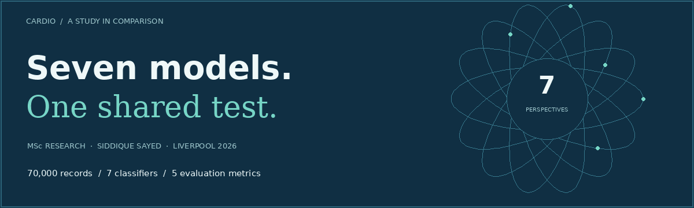

<p align="center"></p>

# Cardiovascular disease classification

**Seven classifiers, one controlled comparison.** My COMP702 MSc dissertation at the University of Liverpool explored how model behaviour changes when the data, split and evaluation measures stay consistent.

The interesting result was the trade-off: Random Forest led on accuracy and ROC-AUC; KNN led on recall and F1. A single headline score did not tell the whole story.

**[Explore the visual research page](https://siddique-cardio-research.sayedsiddique1322.chatgpt.site)** · **[Read the dissertation](dist/resources/dissertation.pdf)** · **[Open the notebook](notebooks/analysis.ipynb)** · **[Verification record](docs/VERIFICATION.md)**

The hosted preview and repository are initially private for review. The visual page includes animated orbital artwork, selectable metric rankings, a two-model comparison and an interactive methodology walkthrough. Motion can be paused, and reduced-motion preferences are respected.

## The experiment

| Component | Approach |
| --- | --- |
| Source | 70,000 labelled records from Svetlana Ulianova's Cardiovascular Disease dataset |
| Cleaning | Deterministic plausibility filters; 68,627 records retained |
| Features | Age in years, gender, BMI, systolic/diastolic pressure, cholesterol, glucose, smoking, alcohol and activity |
| Split | 80/20 stratified split; `random_state=42` |
| Development | Five-fold stratified cross-validation; tuned Random Forest and KNN |
| Measures | Accuracy, precision, recall, F1 and ROC-AUC |
| Extra analysis | Correlation, VIF, association tests, feature ablation and separate threshold analysis |

## Reported dissertation results

Values below are the historical primary comparison from Table 3.2 / Appendix A, cross-checked against the original working notebook. They are not substituted with newer rerun scores.

| Model | Accuracy | Precision | Recall | F1 | ROC-AUC |
| --- | ---: | ---: | ---: | ---: | ---: |
| Logistic Regression | 0.7305 | 0.7579 | 0.6689 | 0.7106 | 0.7943 |
| Decision Tree | 0.6417 | 0.6387 | 0.6349 | 0.6368 | 0.6418 |
| Random Forest (tuned) | **0.7389** | 0.7698 | 0.6736 | 0.7185 | **0.8062** |
| AdaBoost | 0.7309 | **0.7699** | 0.6504 | 0.7051 | 0.7984 |
| Linear SVM | 0.7277 | 0.7605 | 0.6563 | 0.7046 | 0.7943 |
| KNN (tuned) | 0.7347 | 0.7539 | **0.6885** | **0.7197** | 0.7970 |
| Gaussian Naive Bayes | 0.7111 | 0.7595 | 0.6087 | 0.6758 | 0.7816 |

Small differences between the strongest models were not shown to be statistically significant. Feature-ablation experiments found no material predictive improvement from the engineered feature representations. The unrestricted Decision Tree showed overfitting.

## Run the analysis

Use Python 3.11 or 3.12 in a virtual environment. The original experiment did not retain a dependency lockfile; `requirements.txt` gives starting compatibility ranges, while `results/reproduction_environment.json` records the environment used for the portfolio's primary held-out rerun.

```bash
python -m venv .venv
source .venv/bin/activate
pip install -r requirements.txt
python scripts/prepare_data.py --input /path/to/cardio_train.csv
python scripts/reproduce_holdout.py
jupyter lab notebooks/analysis.ipynb
```

Obtain the source CSV from [the dataset's Kaggle page](https://www.kaggle.com/datasets/sulianova/cardiovascular-disease-dataset). Source and cleaned records are deliberately excluded because the dissertation records the dataset licence as unknown. Review the source's current terms before use.

The preparation script recreates and validates the expected row counts. The holdout script runs the seven final estimator configurations; the notebook includes the broader CV, feature and threshold workflow. The notebook is supplied without stored outputs. Its optional full tuning searches are not run by default and can take significant time.

**Verification:** all seven primary models were rerun for this portfolio. Their scores differ slightly from the historical dissertation table; the causes have not been established. Rerun results and deltas are saved separately in `results/`. Full notebook execution, full CV and tuning were not rerun. See [the detailed verification record](docs/VERIFICATION.md).

## Open the visual page locally

The page is buildless HTML, CSS and JavaScript, with no API keys or external libraries.

```bash
python -m http.server 8080 --directory dist
```

Open `http://localhost:8080`. Charts read `dist/results.js`; the downloadable CSV contains the same historical values. The orbital artwork is an abstract visual motif, not a patient signal or model output.

## Files

| Path | Contents |
| --- | --- |
| `notebooks/analysis.ipynb` | Recovered final analysis notebook with a new portfolio provenance note |
| `scripts/prepare_data.py` | Recreates the documented cleaning rules |
| `scripts/reproduce_holdout.py` | Fits and evaluates the seven primary configurations |
| `results/final_model_comparison.csv` | Historical reported figures |
| `results/reproduced_model_comparison.csv` | Separate current-environment rerun |
| `results/reproduction_deltas.csv` | Rerun minus historical values |
| `dist/` | Visual research website and downloadable resources |
| `docs/VERIFICATION.md` | Source provenance, verification scope and limitations |

## Scope and authorship

This is an academic classification study, not a clinical diagnostic product. It uses one public dataset without independent external validation; probability calibration and confidence intervals were outside the completed work. Feature importance is not a causal explanation.

**Siddique Sayed** · MSc Advanced Data Science & AI · University of Liverpool · September 2026.

The dissertation's declaration of generative AI assistance is retained in the PDF. The website, animated cover, preparation/verification scripts and portfolio documentation were added in November 2026 with AI assistance. They are presentation and packaging additions, not claims of extra dissertation experiments.

[GitHub profile](https://github.com/Siddique-SID) · [LinkedIn](https://www.linkedin.com/in/siddiquesayed124)
